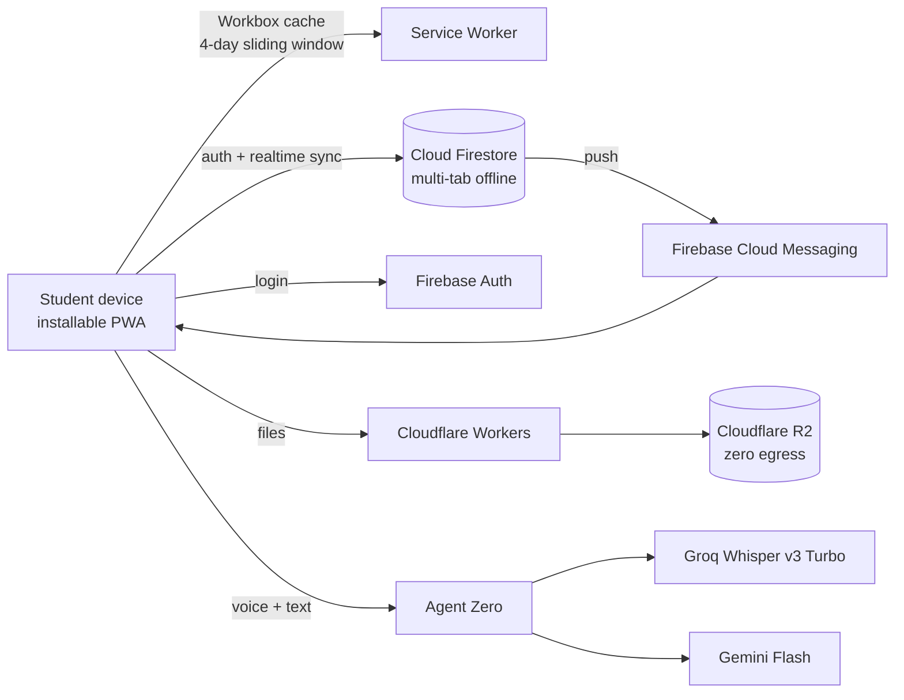

<div align="center">


<a href="https://lalankr.in">
  
</a>

<br/>

[](https://lalankr.in)
[](https://me26b.lalankr.in)
[](https://linkedin.com/in/lalankr08)
[](https://instagram.com/lalankr.08)


</div>

---

## About

```python
class Lalan:
    name      = "Lalan Kumar"
    handle    = "lalankr08"
    studying  = "B.Tech, Mechanical Engineering @ IIT Madras (2026-2030)"
    building  = ["autonomous AI pipelines", "full-stack web apps", "Android apps", "robotics"]
    approach  = "ship end to end: design, firmware, backend, deploy"
    won       = "1st place, Smart Bengal Hackathon 2023"
    reach_me  = "https://lalankr.in"
```

---

## Currently building

| Project | What it is | Stack |
|---|---|---|
| [ME26B Batch Portal](https://me26b.lalankr.in) | Installable, offline-first PWA for my whole batch: timetable, mess menu, notices, events, cached course material, plus an AI assistant ("Agent Zero") | React 19, TypeScript, Vite, Firebase, Cloudflare Workers + R2 |
| Lecture Notes Pipeline | Lecture audio, PPTs and PDFs in; LaTeX, Markdown notes and a Q&A vector store out | Python, FastAPI, WhisperX, Gemini Flash, Supabase pgvector |
| ESP32 PID Approach Robot | Closed-loop ultrasonic distance control, stops exactly 25.0 cm from an obstacle | ESP32, C++, PID, ESP-NOW |

---

## Architecture: ME26B Batch Portal



---

## Tech stack

### Languages
<p>
  
</p>

### Frontend and mobile
<p>
  
</p>

`React 19` `TypeScript` `Vite` `Tailwind v4` `WebGL / GLSL shaders` `Workbox PWA` `PDF.js` `Android SDK (Java, XML)`

### Backend, cloud and data
<p>
  
</p>

`FastAPI` `Cloudflare Workers` `Cloudflare R2` `Cloud Firestore` `Firebase Auth + FCM` `Supabase pgvector`

### AI and ML
<p>
  
</p>

`Whisper / WhisperX` `Gemini Flash` `Groq` `OpenCV` `CNNs` `Vector search (pgvector)` `LLM agents and pipelines`

### Embedded and robotics
<p>
  
</p>

`ESP32` `ESP-NOW` `Raspberry Pi Pico (RP2040)` `MicroPython` `PID control` `L298N / H-bridge motor drivers` `UART` `PWM`

### Tools
<p>
  
</p>

`Git` `GitHub` `Linux` `VS Code` `LaTeX` `FFmpeg` `Discord / Telegram APIs`

---

## Highlights

| Year | Milestone |
|---|---|
| 2026 | Joined IIT Madras, B.Tech Mechanical Engineering |
| 2026 | Shipped the ME26B Batch Portal to production |
| 2026 | ESP32 ultrasonic PID robot |
| 2025 | CSES algorithm solutions in C++ (graphs, DP, segment trees) |
| 2023 | 1st prize, Smart Bengal Hackathon: real-time emotion detector (OpenCV, CNNs) |
| 2021 | Live cricket score Android widget, about 500 installs on Google Play |
| 2021-22 | Phone-controlled robot car (Pico, MicroPython, native Android app) |

---

## GitHub stats

<div align="center">


<br/>


</div>

---

## Contribution snake

<div align="center">
  <picture>
    <source media="(prefers-color-scheme: dark)" srcset="https://raw.githubusercontent.com/lalankr08/lalankr08/output/github-snake-dark.svg" />
    <source media="(prefers-color-scheme: light)" srcset="https://raw.githubusercontent.com/lalankr08/lalankr08/output/github-snake.svg" />
    
  </picture>
</div>

---
---

<div align="center">


[lalankr.in](https://lalankr.in) | [LinkedIn](https://linkedin.com/in/lalankr08) | [Instagram](https://instagram.com/lalankr.08)


</div>
